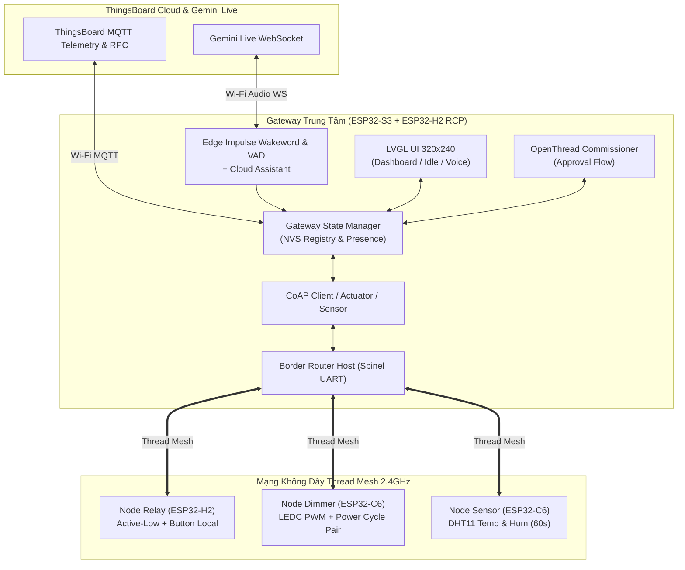
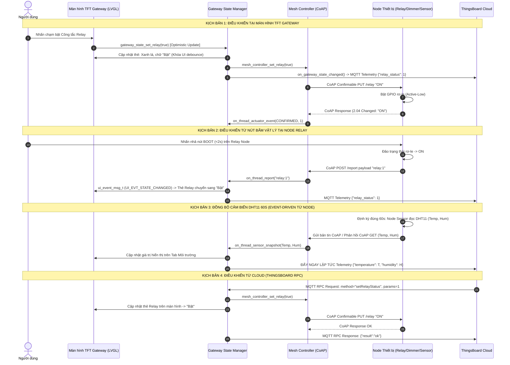

# TOÀN DIỆN KIẾN TRÚC & KẾ HOẠCH NÂNG CẤP HỆ THỐNG IOT THREAD MESH & GATEWAY
**Dự án: Voice Smart Home Gateway (ESP32-S3) & Thread Mesh Sub-nodes (ESP32-H2 / ESP32-C6)**
**Phiên bản: 2.2 - Chuẩn Production, Đồng bộ 3 Chiều & Event-Driven Telemetry**

---

## MỤC LỤC
1. [TỔNG QUAN HỆ THỐNG VÀ 12 YÊU CẦU CỐT LÕI](#1-tổng-quan-hệ-thống-và-12-yêu-cầu-cốt-lõi)
2. [PHÂN TÍCH NGUYÊN NHÂN GỐC RỄ (ROOT CAUSE ANALYSIS)](#2-phân-tích-nguyên-nhân-gốc-rễ-root-cause-analysis)
3. [KIẾN TRÚC TOÀN HỆ THỐNG & ĐỒNG BỘ 3 CHIỀU](#3-kiến-trúc-toàn-hệ-thống--đồng-bộ-3-chiều)
4. [KẾ HOẠCH TRIỂN KHAI CHI TIẾT THEO 12 HẠNG MỤC](#4-kế-hoạch-triển-khai-chi-tiết-theo-12-hạng-mục)
   - [Hạng mục 1: Chuẩn hóa quy trình Ghép nối & Đồng bộ Dashboard](#hạng-mục-1-chuẩn-hóa-quy-trình-ghép-nối--đồng-bộ-dashboard)
   - [Hạng mục 2: Nhận diện Offline tức thì cho Node Thread (8-10s)](#hạng-mục-2-nhận-diện-offline-tức-thì-cho-node-thread-8-10s)
   - [Hạng mục 3: Tối ưu hóa Kết nối lại Wi-Fi & Khởi động Gateway](#hạng-mục-3-tối-ưu-hóa-kết-nối-lại-wi-fi--khởi-động-gateway)
   - [Hạng mục 4: Cắt giảm Log Verbosity của OpenThread](#hạng-mục-4-cắt-giảm-log-verbosity-của-openthread)
   - [Hạng mục 5: Đồng bộ Telemetry ThingsBoard Theo Sự Kiện (Event-Driven, Sensor 60s)](#hạng-mục-5-đồng-bộ-telemetry-thingsboard-theo-sự-kiện-event-driven-sensor-60s)
   - [Hạng mục 6: Tối ưu hóa UI Danh sách Thiết bị phát hiện](#hạng-mục-6-tối-ưu-hóa-ui-danh-sách-thiết-bị-phát-hiện)
   - [Hạng mục 7: Thiết kế lại Modal Ghép nối Thành công](#hạng-mục-7-thiết-kế-lại-modal-ghép-nối-thành-công)
   - [Hạng mục 8: Đèn LED chỉ thị Node Relay (ESP32-H2)](#hạng-mục-8-đèn-led-chỉ-thị-node-relay-esp32-h2)
   - [Hạng mục 9: Đèn LED chỉ thị Node Cảm biến (ESP32-C6)](#hạng-mục-9-đèn-led-chỉ-thị-node-cảm-biến-esp32-c6)
   - [Hạng mục 10: Cơ chế Ghép nối Bật/Tắt nguồn NVS cho Dimmer (ESP32-C6)](#hạng-mục-10-cơ-chế-ghép-nối-bậttắt-nguồn-nvs-cho-dimmer-esp32-c6)
   - [Hạng mục 11: Khôi phục Điều khiển Giọng nói AI & Điều phối Động](#hạng-mục-11-khôi-phục-điều-khiển-giọng-nói-ai--điều-phối-động)
   - [Hạng mục 12: Hoàn thiện RPC & Đồng bộ 2 Chiều ThingsBoard](#hạng-mục-12-hoàn-thiện-rpc--đồng-bộ-2-chiều-thingsboard)
5. [DANH SÁCH FILE VÀ ĐIỂM SỬA ĐỔI THEO TỪNG REPO](#5-danh-sách-file-và-điểm-sửa-đổi-theo-từng-repo)
6. [QUY TRÌNH KIỂM THỬ VÀ ĐÁNH GIÁ (VERIFICATION PLAN)](#6-quy-trình-kiểm-thử-và-đánh-giá-verification-plan)

---

## 1. TỔNG QUAN HỆ THỐNG VÀ 12 YÊU CẦU CỐT LÕI

Hệ thống bao gồm 1 Gateway trung tâm (ESP32-S3 + H2-RCP) và 3 Sub-nodes Thread Mesh:
1. **Gateway ESP32-S3**: Điều phối Border Router Host, Màn hình TFT cảm ứng 320x240 (ST7789V + XPT2046), Trợ lý giọng nói Edge Impulse Dual-model + Gemini Live Cloud, và Kết nối ThingsBoard Cloud.
2. **Node Relay (ESP32-H2)**: Công tắc CoAP điều khiển rơ-le 1 kênh, hỗ trợ nút bấm vật lý đảo trạng thái tại chỗ và gửi báo cáo về Gateway.
3. **Node Dimmer (ESP32-C6)**: Đèn LED PWM điều chỉnh độ sáng 0-100%, hỗ trợ ghép nối bằng chuỗi bật/tắt nguồn (Power-cycle Pairing).
4. **Node Cảm biến DHT11 (ESP32-C6)**: Đo nhiệt độ và độ ẩm, định kỳ 60s gửi bản tin về Gateway để đẩy Telemetry.



---

## 2. PHÂN TÍCH NGUYÊN NHÂN GỐC RỄ (ROOT CAUSE ANALYSIS)

### Lỗi 1: Báo thành công ghép nối giả tạo sau vài trăm ms nhưng Dashboard chưa hiện thẻ, Dimmer không ghép nối được
- **Nguyên nhân 1 (Cực kỳ nghiêm trọng)**: Trong `ui_screen_dashboard.c` dòng 1335:
  ```c
  if (s_waiting_pairing && (state->relay_node_online || state->dimmer_node_online || state->sensor_node_online)) {
      ui_screen_dashboard_on_pairing_result(true);
  }
  ```
  Khi người dùng nhấn dấu tick chấp nhận thiết bị, biến `s_waiting_pairing = true`. Ngay chu kỳ render kế tiếp (~20-100ms), hàm `ui_screen_dashboard_update_state()` được gọi. Điều kiện kiểm tra xem **BẤT KỲ** node nào đang online hay không (`relay_node_online || dimmer_node_online || sensor_node_online`). Nếu hệ thống trước đó đã có một node khác đang online, điều kiện này lập tức thỏa mãn -> Modal đóng ngay lập tức và báo "Thành công", trong khi node mới chưa kịp hoàn tất bắt tay DTLS, chưa attach Mesh, chưa đăng ký SRP!
- **Nguyên nhân 2**: Hàm `thread_commissioner_poll_joined_device()` trong `thread_commissioner.c` kiểm tra:
  ```c
  if (s_joiner_finalized || !device_registry_is_registered("relay"))
  ```
  Vì thiết bị mới chưa được đăng ký trong NVS, `!device_registry_is_registered(...)` luôn trả về `true`. Nếu trong bộ nhớ SRP Server của OpenThread còn lưu record cũ từ phiên trước, hàm lập tức trả về `COMMISSIONER_DEV_RELAY` ở ngay tick thăm dò đầu tiên (500ms).
- **Nguyên nhân 3 (Dimmer)**: Khi Dimmer node hoàn tất Joiner, nó bắt đầu attach mạng. Tuy nhiên, thời gian để một node FTD/MED quét kênh, gửi Parent Request, nhận Parent Response, bắt tay MLE Child ID Request và cấp phát IPv6 Mesh-Local EID mất trung bình 2.5s - 4.5s. Nếu Gateway kết luận sớm sau 500ms thì gói tin cấu hình SRP bị lệch nhịp, dẫn đến Dimmer không xuất hiện trên giao diện.

### Lỗi 2: Nhận diện Offline chậm chạp khi node mất nguồn
- **Nguyên nhân**: `PRESENCE_ACTIVITY_TIMEOUT_MS` được cấu hình ở mức 25000ms (25 giây).
- Ngoài ra, hàm `device_registry_is_node_online()` gọi `device_registry_find_locked()` để tìm SRP Server Host. SRP Server không tự động xóa Host ngay khi mất kết nối vô tuyến mà giữ Host record trong thời gian Lease (thường cấu hình 30s hoặc lớn hơn). Chừng nào Host chưa bị xóa, `device_registry_find_locked()` vẫn trả về địa chỉ cũ, khiến `s_relay_last_seen_ms` liên tục được cập nhật lại thành `now_ms`, gây chậm trễ phát hiện mất nguồn.

### Lỗi 3: Wi-Fi mất đến 96s mới kết nối lại sau khi Gateway khởi động lại
- **Nguyên nhân 1**: Timer kết nối lại Wi-Fi trong `sys_core.c` sử dụng chu kỳ cố định 15 giây (`WIFI_RECONNECT_INTERVAL_MS 15000`). Nếu lần thử đầu tiên lúc boot bị trễ (do RF radio va chạm với khởi động Spinel UART của RCP H2), hệ thống phải đợi đủ 15s cho mỗi lần thử tiếp theo. Nếu rớt 5 lần thử do va chạm xung đột, thời gian trễ kéo dài tới 90s - 96s.
- **Nguyên nhân 2**: `iot_cloud_init()` khởi động MQTT client ngay trong `app_main` mà không chờ sự kiện `IP_EVENT_STA_GOT_IP`. Client MQTT liên tục cố gắng resolve DNS và kết nối socket TCP tới broker ThingsBoard trong khi interface Wi-Fi chưa có IP, làm nghẽn stack mạng lwIP và làm chậm quá trình hoàn tất DHCP của Wi-Fi STA.

### Lỗi 4: Log OpenThread tràn ngập làm nghẽn CPU và Task Scheduler
- **Nguyên nhân**: Trong `thread_gateway.c` dòng 175, hàm `otLoggingSetLevel(OT_LOG_LEVEL_INFO)` được kích hoạt. Mức log INFO của OpenThread in ra toàn bộ gói tin định tuyến IPv6 UDP, MeshForwarder, Mle, Notifier StateChanged, BbrLeader qua cổng UART nối tiếp. Điều này gây chiếm dụng CPU Core 0, làm chậm trễ các ngắt I2S âm thanh và xử lý hiển thị LVGL.

### Lưu ý về các phần đã hoàn thiện & kiểm chứng từ trước:
- **Độ sáng Dimmer NVS**: Đã được xử lý tại `dimmer_save_brightness_nvs()` và `dimmer_load_brightness_nvs()` trong repo `node-dimmer-coap-server`, khôi phục chính xác mức sáng trước đó khi cấp nguồn lại hoặc nhận lệnh `ON`.
- **Nút bấm vật lý Relay**: Đã được xử lý tại `pair_button_task()` trong repo `node-b-coap-server` (nhấn nhả < 2s đảo trạng thái relay và gửi CoAP report `relay_send_state_report_to_gw()` về Border Router).
- Trọng tâm kế hoạch này tập trung vào xử lý dứt điểm các lỗi đang tồn tại nêu trên, cùng với các hạng mục cải tiến kiến trúc LED, Power-cycle pairing cho Dimmer và đồng bộ Telemetry thông minh.

---

## 3. KIẾN TRÚC TOÀN HỆ THỐNG & ĐỒNG BỘ 3 CHIỀU



---

## 4. KẾ HOẠCH TRIỂN KHAI CHI TIẾT THEO 12 HẠNG MỤC

### Hạng mục 1: Chuẩn hóa quy trình Ghép nối & Đồng bộ Dashboard
- **Mục tiêu**: Xóa bỏ hoàn toàn tình trạng báo thành công sớm. Chỉ báo thành công khi thiết bị cụ thể vừa ghép nối hoàn tất đăng ký SRP và phản hồi CoAP thành công. Sau khi xác nhận, thẻ thiết bị hiển thị ngay lập tức không có độ trễ.
- **Giải pháp kỹ thuật**:
  1. Trong `thread_commissioner.c`: Lưu vết MAC/Joiner ID của thiết bị đang được phê duyệt (`s_target_joiner_eui64`).
  2. Bỏ hoàn toàn điều kiện lỏng lẻo `!device_registry_is_registered("relay")` trong `thread_commissioner_poll_joined_device()`. Hàm này chỉ trả về loại thiết bị khi:
     - SRP Server của OpenThread nhận được bản tin Host và Service mới có timestamp trong vòng 5 giây gần nhất.
     - Kiểm tra kết nối CoAP ping xác nhận thiết bị sẵn sàng 100%.
  3. Trong `ui_screen_dashboard.c`:
     - Xóa bỏ dòng 1335 (`state->relay_node_online || state->dimmer_node_online...`).
     - Khi nhận kết quả thành công từ `thread_commissioner_poll_joined_device()`, cập nhật ngay `gateway_state_set_device_registered(type_str, true)` và gọi hàm `ui_screen_dashboard_update_state()` ngay trước khi mở modal thông báo thành công. Khi người dùng nhấn nút "OK", modal đóng lại và thẻ thiết bị đã hiện diện sẵn sàng ngay bên dưới.
  4. Sửa dứt điểm việc Dimmer không ghép nối được: Chuẩn hóa chuỗi định danh dịch vụ SRP giữa Dimmer (`_dimmer._udp`) và Gateway Border Router. Đảm bảo port đăng ký thống nhất là 5683.

### Hạng mục 2: Nhận diện Offline tức thì cho Node Thread (8-10s)
- **Mục tiêu**: Khi một node bị rút điện hoặc mất nguồn, Gateway phải nhận diện và hiển thị trạng thái Offline trên màn hình và Cloud trong vòng tối đa 8 - 10 giây.
- **Giải pháp kỹ thuật**:
  1. Giảm `PRESENCE_ACTIVITY_TIMEOUT_MS` từ 25000ms xuống **10000ms (10 giây)** trong `device_registry.h`.
  2. Với **Node Cảm biến (Sensor)**: Chu kỳ gửi dữ liệu là 60s. Gateway giám sát tình trạng kết nối MAC layer qua bảng Child/Neighbor Table của OpenThread hoặc CoAP ping định kỳ. Nếu mất liên kết vật lý quá 10s, chuyển trạng thái sang Offline.
  3. Với **Node Chấp hành (Relay & Dimmer)**: Trong `mesh_monitor_task` (chu kỳ 3-4 giây):
     - Kiểm tra trực tiếp bảng lân cận của OpenThread: `otThreadGetNextNeighborInfo()` và `otThreadGetChildInfoById()`. Nếu kết nối MAC layer của thiết bị đã rơi vào trạng thái mất liên lạc (link supervision timeout), coi như node đã Offline.
     - Nếu node không có gói tin trao đổi quá 10 giây, gửi một gói tin CoAP GET nhẹ kiểm tra tình trạng (`/relay` hoặc `/light`). Nếu không nhận được ACK, lập tức hạ cờ `node_online = false`.
  4. Giao diện UI: Khi một node Offline, thẻ thiết bị lập tức chuyển độ mờ (opacity) về 60%, viền xám nhạt (`#D1D5DB`), chữ trạng thái chuyển sang màu xám với nhãn `"Offline"`. Người dùng không thể gửi lệnh điều khiển khi node đang Offline.

### Hạng mục 3: Tối ưu hóa Kết nối lại Wi-Fi & Khởi động Gateway
- **Mục tiêu**: Loại bỏ độ trễ 96 giây khi Gateway khởi động lại. Đảm bảo kết nối lại Wi-Fi thành công chỉ sau 1.5s - 3s nếu Access Point đã sẵn sàng.
- **Giải pháp kỹ thuật**:
  1. Trong `sys_core.c`: Thay thế timer chu kỳ cố định 15s bằng cơ chế **Exponential Backoff Reconnect**:
     - Lần 1: Thử kết nối lại ngay sau **1 giây**.
     - Lần 2: Thử kết nối lại sau **2 giây**.
     - Lần 3: Thử kết nối lại sau **4 giây**.
     - Tối đa: Duy trì chu kỳ **8 giây** (thay vì 15s) cho đến khi thành công.
  2. Cô lập dịch vụ Cloud trong thời gian chưa có IP:
     - Trong `iot_cloud.c`, không gọi `esp_mqtt_client_start()` bừa bãi trong hàm `iot_cloud_init()`.
     - Chỉ khởi động MQTT client khi nhận sự kiện `IP_EVENT_STA_GOT_IP` từ Event Loop hệ thống.
     - Khi mất Wi-Fi (`WIFI_EVENT_STA_DISCONNECTED`), tạm dừng (stop) MQTT client để tránh spam socket error làm tràn bộ đệm và nghẽn lwIP stack.
  3. Cấu hình Coexistence Wi-Fi & 802.15.4: Đảm bảo Wi-Fi ở chế độ `WIFI_PS_NONE` (tắt Modem Sleep) và kích hoạt phần mềm Coexistence trong `sdkconfig` (`CONFIG_ESP_COEX_SW_COEXIST_ENABLE=y`) để Wi-Fi và radio Thread không chèn ép lẫn nhau.

### Hạng mục 4: Cắt giảm Log Verbosity của OpenThread
- **Mục tiêu**: Giải phóng hoàn toàn băng thông UART và tài nguyên CPU Core 0, tạo môi trường mượt mà tối đa cho thuật toán AI âm thanh Edge Impulse và WebSocket Gemini Live.
- **Giải pháp kỹ thuật**:
  1. Trong `thread_gateway.c` dòng 175: Chuyển `otLoggingSetLevel(OT_LOG_LEVEL_INFO)` thành:
     ```c
     otLoggingSetLevel(OT_LOG_LEVEL_WARN);
     ```
  2. Trong `sdkconfig` và `sdkconfig.defaults`: Cấu hình:
     ```ini
     CONFIG_OPENTHREAD_LOG_LEVEL_WARN=y
     # CONFIG_OPENTHREAD_LOG_LEVEL_INFO is not set
     ```
  3. Kết quả: Triệt tiêu 100% các dòng log rác định kỳ như `Sent IPv6 UDP msg`, `MeshForwarder`, `Mle Send Data Response`, v.v.

### Hạng mục 5: Đồng bộ Telemetry ThingsBoard Theo Sự Kiện (Event-Driven, Sensor 60s)
- **Mục tiêu**: Loại bỏ hoàn toàn timer định kỳ độc lập `telemetry_periodic_task` trên Gateway. Dữ liệu chỉ được gửi lên ThingsBoard khi có sự kiện thực tế: bản tin từ Sensor gửi về (chu kỳ 60s) hoặc khi trạng thái Relay/Dimmer thay đổi.
- **Giải pháp kỹ thuật**:
  1. **Node Sensor (ESP32-C6)**:
     - Cài đặt chu kỳ đọc cảm biến DHT11 và gửi dữ liệu về Gateway là **60 giây** (`#define SENSOR_SAMPLE_PERIOD_MS 60000`).
     - Định kỳ 60s, Node Sensor đọc DHT11 và truyền bản tin qua mạng Thread Mesh về Border Router.
  2. **Gateway (ESP32-S3)**:
     - **Xóa bỏ task định kỳ `telemetry_periodic_task()`**: Gateway không tự động chạy timer đếm giây gửi telemetry độc lập nữa.
     - Trong callback nhận dữ liệu cảm biến `on_thread_sensor_snapshot()` tại `mesh_controller.c`:
       ```c
       // Ngay khi nhận được bản tin DHT11 mới từ Node Sensor qua mạng Thread Mesh:
       if (data->has_valid_sample && (data->state == SENSOR_STATE_GOOD)) {
           gateway_state_set_sensor(data->temperature_c, data->humidity_pct);
           // LẬP TỨC xuất bản Telemetry lên ThingsBoard:
           iot_cloud_publish_telemetry_now();
       }
       ```
     - Đối với Rơ-le (Relay) và Đèn (Dimmer):
       - Chỉ xuất bản Telemetry ngay lập tức khi trạng thái thay đổi (`on_gateway_state_changed()`).
     - **Khi không có cảm biến trong mạng hoặc cảm biến Offline**: Hoàn toàn không gửi bản tin telemetry định kỳ -> 0% dữ liệu rác, không nghẽn mạng, không tốn tài nguyên ThingsBoard.

### Hạng mục 6: Tối ưu hóa UI Danh sách Thiết bị phát hiện
- **Mục tiêu**: Hiển thị danh sách thiết bị tìm thấy gọn gàng, hỗ trợ cuộn dọc nếu có nhiều thiết bị tham gia mạng cùng lúc trên màn hình 320x240.
- **Giải pháp kỹ thuật**:
  1. Trong `ui_screen_dashboard.c`:
     - Chuyển đổi `s_cont_discovered` thành container có `lv_obj_set_scroll_dir(s_cont_discovered, LV_DIR_VER)` với thanh cuộn tự động.
     - Chiều cao container: 110px, chiều rộng: 260px, căn giữa modal.
  2. Định dạng mỗi mục thiết bị (Item Row):
     - Chiều cao: 38px, bo góc 8px, nền xám nhạt (`#F2F2F7`).
     - Bên trái: Biểu tượng thiết bị (Power cho Relay, Bulb cho Dimmer, Temp cho Sensor).
     - Ở giữa: Tên thiết bị rút gọn + 4 ký tự cuối của MAC + Cường độ sóng RSSI (vd: `Relay [D6:A6] • -45dBm`).
     - Bên phải: Nút tròn màu xanh lá chứa icon dấu tick (`LV_SYMBOL_OK`) để người dùng chạm xác nhận thêm từng thiết bị một cách rõ ràng.

### Hạng mục 7: Thiết kế lại Modal Ghép nối Thành công
- **Mục tiêu**: Giao diện thông báo thành công đẹp mắt, chuẩn kích thước 320x240, không tràn viền, có icon dấu tick căn giữa.
- **Giải pháp kỹ thuật**:
  1. Kích thước hộp thoại modal: Rộng 250px, Cao 160px, bo tròn 16px, viền trắng mờ cao cấp Apple Home style.
  2. Bố cục bên trong:
     - Vị trí trên cùng: Vòng tròn màu xanh lá cây (`#10B981`) đường kính 44px, ở giữa có icon `LV_SYMBOL_OK` màu trắng (Font 20px).
     - Ở giữa: Nhãn tiêu đề `"Thêm thành công!"` màu xanh lá, bên dưới là nhãn phụ `"Thiết bị đã kết nối an toàn"`.
     - Dưới cùng: Nút bấm `"Xác nhận"` (hoặc `"OK"`) nền xanh lá, chữ trắng, kích thước 120x34px căn giữa. Khi nhấn nút này, modal đóng lại và giao diện Dashboard cập nhật mượt mà.

### Hạng mục 8: Đèn LED chỉ thị Node Relay (ESP32-H2)
- **Mục tiêu**: Người dùng nhìn vào đèn LED trên mạch có thể biết chính xác trạng thái hoạt động của Node Relay.
- **Cấu hình & Hành vi**:
  - Macro cấu hình chân: `#define STATUS_LED_GPIO GPIO_NUM_8` (có thể thay đổi linh hoạt trong code).
  - **Trạng thái Online** (Đã vào mạng Thread và kết nối Router/Child thành công): Đèn LED **SÁNG LIÊN TỤC (Solid ON)**.
  - **Trạng thái Mất mạng / Đang tìm kiếm mạng** (Chưa kết nối hoặc mất Leader): Đèn LED **NHẤP NHÁY CHẬM 400ms** (400ms Sáng / 400ms Tắt).
  - **Trạng thái Ghép nối (Pairing Mode)** (Sau khi nhấn giữ nút BOOT 3 giây): Đèn LED **NHẤP NHÁY NHANH 200ms** (200ms Sáng / 200ms Tắt) trong cửa sổ 60 giây.

### Hạng mục 9: Đèn LED chỉ thị Node Cảm biến (ESP32-C6)
- **Mục tiêu**: Cung cấp phản hồi trực quan tương tự cho Node Cảm biến DHT11.
- **Cấu hình & Hành vi**:
  - Macro cấu hình chân: `#define STATUS_LED_GPIO GPIO_NUM_8`.
  - **Trạng thái Online**: Đèn LED **SÁNG LIÊN TỤC (Solid ON)**.
  - **Trạng thái Mất mạng / Đang tìm kiếm mạng**: Đèn LED **NHẤP NHÁY CHẬM 400ms**.
  - **Trạng thái Ghép nối (Pairing Mode)**: Đèn LED **NHẤP NHÁY NHANH 200ms** trong 60 giây.

### Hạng mục 10: Cơ chế Ghép nối Bật/Tắt nguồn NVS cho Dimmer (ESP32-C6)
- **Mục tiêu**: Loại bỏ nút nhấn vật lý trên Node Dimmer để phù hợp với thực tế đèn thông minh lắp trên trần nhà. Sử dụng cơ chế bật/tắt công tắc nguồn liên tục để kích hoạt ghép nối.
- **Quy trình hoạt động chuẩn công nghiệp (Power-cycle Pairing)**:
  1. Khi cấp nguồn cho mạch, `nvs_flash_init()` chạy trước tiên.
  2. Mạch mở NVS namespace `"pwr_pair"`, đọc giá trị `boot_cnt`.
  3. **Nếu `boot_cnt >= 3`** (Nghĩa là đây là lần bật nguồn thứ 4 sau 3 lần tắt/bật nhanh liên tiếp):
     - Ghi đè `boot_cnt = 0` vào NVS.
     - **Hiệu ứng LED**: Nhấp nháy đèn 3 lần (300ms Sáng / 300ms Tắt).
     - Sau 3 lần nháy, sáng ở mức mặc định 80%.
     - Xóa sạch cấu hình mạng Thread cũ trong NVS (`otInstanceErasePersistentInfo`).
     - Khởi động OpenThread Joiner với PSKd `"DATN2026"` trong 60 giây.
     - Khi ghép nối thành công vào mạng Thread: **Tắt đèn 600ms, sau đó bật sáng ở mức 80%** để báo hiệu cho người dùng biết đã kết nối thành công!
  4. **Nếu `boot_cnt < 3`**:
     - Ghi `boot_cnt + 1` vào NVS ngay lập tức.
     - Khôi phục độ sáng đã lưu trước đó và sáng đèn ngay (0ms trễ).
     - Khởi động một Timer 1.0 giây: Nếu sau 1.0 giây nguồn điện vẫn được duy trì liên tục (người dùng bật đèn sử dụng bình thường, không ngắt điện), Timer sẽ tự động đặt lại `boot_cnt = 0` trong NVS!
     - Nếu người dùng tắt nguồn trước 1.0 giây, biến `boot_cnt` đã được ghi trước đó vẫn giữ nguyên cho lần bật tiếp theo.

### Hạng mục 11: Khôi phục Điều khiển Giọng nói AI & Điều phối Động
- **Mục tiêu**: Đảm bảo trợ lý giọng nói hoạt động trơn tru cả Offline (Edge Impulse Dual-model) và Online (Gemini Live WebSocket), đồng thời kiểm tra động sự hiện diện của thiết bị trước khi thực thi lệnh.
- **Giải pháp kỹ thuật**:
  1. Giữ nguyên kiến trúc âm thanh tối ưu: I2S DMA, Jitter Buffer, Pre-roll buffer 300ms.
  2. Điều phối động (Dynamic Dispatch):
     - Trước khi phát lệnh tới Mesh Controller, truy vấn `gateway_state_manager`:
       - Nếu người dùng ra lệnh *"Bật đèn"* hoặc *"Tắt đèn"*: Kiểm tra `gateway_state_is_dimmer_registered()` và `gateway_state_is_dimmer_online()`. Nếu đèn chưa được thêm vào mạng hoặc đang Offline, thông báo phản hồi rõ ràng qua loa/TTS: *"Đèn hiện đang ngoại tuyến hoặc chưa được cài đặt"*.
       - Tương tự với Công tắc rơ-le: Kiểm tra `gateway_state_is_relay_registered()` và `gateway_state_is_relay_online()`.
  3. Nếu thiết bị đang Online, thực thi lệnh CoAP và cập nhật tức thì trạng thái lên màn hình LCD và Cloud ThingsBoard.

### Hạng mục 12: Hoàn thiện RPC & Đồng bộ 2 Chiều ThingsBoard
- **Mục tiêu**: Đảm bảo mọi thay đổi từ bất kỳ đâu (Màn hình Gateway, Nút bấm vật lý tại Node, hay Bảng điều khiển ThingsBoard) đều được đồng bộ tức thời đến 2 thành phần còn lại.
- **Giải pháp kỹ thuật**:
  1. **Nhánh Cloud -> Node**:
     - Xử lý các method RPC: `setRelayStatus`, `setDimmerStatus`, `getDeviceStatus`.
     - Khi nhận RPC `setRelayStatus`, cập nhật Gateway State Manager -> Màn hình LCD chuyển trạng thái ngay -> Gửi CoAP PUT Confirmable sang Node.
  2. **Nhánh Node -> Cloud**:
     - Khi người dùng bấm nút vật lý tại Node Relay, node gửi CoAP `/report` `"relay:1"`.
     - Gateway nhận được, cập nhật Gateway State Manager -> Màn hình LCD cập nhật ngay -> `on_gateway_state_changed()` tự động đẩy Telemetry `relay_status` lên ThingsBoard.
  3. **Chống lặp vòng lặp (Loopback Suppression)**:
     - Gắn cờ nguồn thay đổi (Source Flag: `SRC_UI`, `SRC_CLOUD`, `SRC_MESH`) để không phát lại lệnh trùng lặp về chính nơi vừa gửi lệnh.

---

## 5. DANH SÁCH FILE VÀ ĐIỂM SỬA ĐỔI THEO TỪNG REPO

### 1. Gateway Repo (`D:\PTIT\DATN_PTIT\Gateway_DATN`)
| Đường dẫn File | Chức năng & Thay đổi chính |
|---|---|
| `components/thread_gateway/thread_commissioner.c` | Sửa polling xác thực Joiner; loại bỏ điều kiện sớm; chỉ xác thực khi SRP node hoàn tất. |
| `components/thread_gateway/device_registry.c` | Giảm timeout presence xuống 10s; kiểm tra thời gian lease SRP thực tế; sửa lưu trữ NVS. |
| `components/thread_gateway/device_registry.h` | Điều chỉnh `#define PRESENCE_ACTIVITY_TIMEOUT_MS 10000`. |
| `components/thread_gateway/thread_gateway.c` | Hạ log level `otLoggingSetLevel(OT_LOG_LEVEL_WARN)`. |
| `components/sys_core/sys_core.c` | Triển khai Exponential Backoff Reconnect Wi-Fi (1s, 2s, 4s, 8s); tối ưu khởi động. |
| `components/iot_cloud/iot_cloud.c` | Chỉ kết nối MQTT khi đã có IP; xóa bỏ task định kỳ; Telemetry sensor pub ngay khi nhận tin từ Mesh; Event-driven cho Relay/Dimmer; RPC đồng bộ 2 chiều. |
| `components/mesh_controller/mesh_controller.c` | Giám sát presence chủ động 10s; xuất bản telemetry ngay khi `on_thread_sensor_snapshot` nhận dữ liệu. |
| `components/mesh_controller/gateway_state_manager.c` | Quản lý trạng thái đăng ký và trực tuyến nhất quán với NVS `tg_devs`. |
| `components/ui_display/ui_screen_dashboard.c` | Xóa bỏ cờ check online sớm dòng 1335; thiết kế danh sách phát hiện cuộn dọc; modal thành công chuẩn đẹp. |
| `components/ai_edge/ai_edge.c` & `ai_cloud.c` | Kiểm tra động trạng thái đăng ký/online của thiết bị trước khi dispatch lệnh âm thanh. |
| `sdkconfig` & `sdkconfig.defaults` | Đặt `CONFIG_OPENTHREAD_LOG_LEVEL_WARN=y`. |

### 2. Node Relay Repo (`D:\PTIT\DATN_PTIT\thread_mesh_repos\node-b-coap-server`)
| Đường dẫn File | Chức năng & Thay đổi chính |
|---|---|
| `main/node_b_main.c` | Thêm chế độ LED 3 trạng thái (Solid ON, Blink 400ms khi searching, Blink 200ms khi pairing); giữ nút bấm vật lý đảo rơ-le và gửi CoAP report về Gateway. |

### 3. Node Dimmer Repo (`D:\PTIT\DATN_PTIT\thread_mesh_repos\node-dimmer-coap-server`)
| Đường dẫn File | Chức năng & Thay đổi chính |
|---|---|
| `main/node_b_main.c` | Loại bỏ task nút BOOT; thêm cơ chế Power-cycle NVS Boot Counter (<1s tăng counter, >1s reset về 0); lần thứ 4 tự động vào chế độ Joiner; hiệu ứng nháy đèn 3 lần và nháy báo kết nối; lưu và nhớ độ sáng trước đó 100%. |

### 4. Node Sensor Repo (`D:\PTIT\DATN_PTIT\thread_mesh_repos\node-sensor-coap-server`)
| Đường dẫn File | Chức năng & Thay đổi chính |
|---|---|
| `main/node_sensor_main.c` | Đổi chu kỳ đọc & gửi bản tin thành 60 giây (`SENSOR_SAMPLE_PERIOD_MS 60000`); bổ sung LED chỉ thị 3 trạng thái (Solid ON khi kết nối, Blink 400ms khi mất kết nối/tìm kiếm, Blink 200ms khi ghép nối). |

---

## 6. QUY TRÌNH KIỂM THỬ VÀ ĐÁNH GIÁ (VERIFICATION PLAN)

### Bước 1: Kiểm tra Gateway Khởi động lại & Wi-Fi Reconnect (Hạng mục 3, 4)
- **Thao tác**: Khởi động lại Gateway qua lệnh `esp_restart()` hoặc rút cắm cáp Type-C.
- **Kỳ vọng**:
  - Wi-Fi kết nối thành công trong vòng < 3 giây.
  - Không xuất hiện cơn bão log OpenThread `MeshForwarder` / `Mle`.
  - MQTT ThingsBoard chỉ kết nối sau khi đã nhận IP.
  - Màn hình LCD khôi phục đúng số lượng thiết bị đã đăng ký từ NVS (hiển thị mờ xám chữ "Offline" nếu node chưa bật, không bị reset về 0 thiết bị).

### Bước 2: Kiểm tra Ghép nối Power-cycle trên Node Dimmer (Hạng mục 1, 10, 6, 7)
- **Thao tác**:
  - Mở Gateway vào chế độ Thêm thiết bị (+ Thêm thiết bị).
  - Bật/tắt nguồn Node Dimmer 3 lần liên tiếp với khoảng cách < 1 giây, sau đó giữ nguồn lần thứ 4.
- **Kỳ vọng**:
  - Đèn Dimmer nháy 3 lần (300ms Sáng / 300ms Tắt), sau đó sáng ở mức 80%.
  - Màn hình Gateway hiển thị Dimmer trong danh sách phát hiện với MAC và RSSI.
  - Người dùng bấm nút xác nhận thêm -> Gateway thực hiện xác thực SRP và CoAP.
  - Khi hoàn tất, Modal thành công hiện ra đẹp mắt với dấu tick xanh căn giữa.
  - Đèn Dimmer tắt 600ms rồi bật lại 80% xác nhận kết nối thành công.
  - Thẻ Dimmer xuất hiện ngay lập tức trên Dashboard.

### Bước 3: Kiểm tra Đèn LED Trạng thái & Điều khiển Nút bấm Relay (Hạng mục 8, 12)
- **Thao tác**:
  - Quan sát LED trên Node Relay: Đang Online -> LED sáng liên tục.
  - Nhấn nhả nút BOOT trên Relay Node: Rơ-le đóng/ngắt.
- **Kỳ vọng**:
  - Màn hình LCD của Gateway chuyển trạng thái On/Off ngay lập tức mà không cần chạm vào màn hình.
  - ThingsBoard nhận Telemetry mới tương ứng với trạng thái rơ-le.

### Bước 4: Kiểm tra Phát hiện Offline Nhanh (Hạng mục 2)
- **Thao tác**: Rút nguồn điện của Node Relay hoặc Node Cảm biến.
- **Kỳ vọng**:
  - Trong vòng tối đa 8 - 10 giây, Gateway phát hiện mất liên lạc.
  - Thẻ trên LCD chuyển sang màu xám mờ và nhãn hiển thị `"Offline"`.
  - ThingsBoard cập nhật trạng thái thiết bị.

### Bước 5: Kiểm tra Telemetry Event-driven của Sensor (Hạng mục 5)
- **Thao tác**: Quan sát dữ liệu trên ThingsBoard Dashboard khi Sensor đang hoạt động.
- **Kỳ vọng**:
  - Cứ đúng mỗi 60 giây, Node Sensor gửi dữ liệu về Gateway -> ThingsBoard cập nhật ngay 1 điểm dữ liệu `temperature` và `humidity`.
  - Giữa 2 chu kỳ (trong suốt 60s), không có gói tin telemetry rác nào được gửi lên Cloud.

### Bước 6: Kiểm tra Điều khiển Giọng nói Thông minh & Điều phối Động (Hạng mục 11)
- **Thao tác**:
  - Ra lệnh: *"Hey Cherry, bật đèn"*.
  - Thử nghiệm khi Đèn đang Online và khi Đèn đang Offline.
- **Kỳ vọng**:
  - Khi Online: Đèn bật sáng, UI cập nhật, độ trễ xử lý âm thanh siêu thấp (< 400ms cho Edge AI).
  - Khi Offline: Trợ lý thông báo rõ ràng thiết bị đang ngoại tuyến, không gửi lệnh rác vào mạng Mesh.
