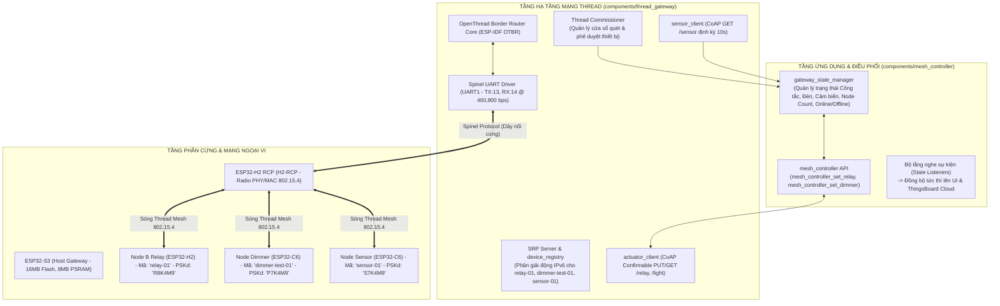
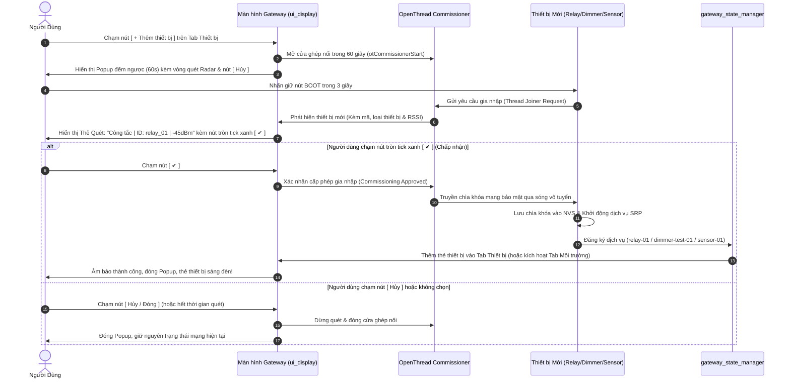

# Bản Thiết Kế Tổng Thể Hệ Thống Thread Mesh (Master System Blueprint)
> **Dự án**: ESP32-S3 Voice Gateway tích hợp Mạng Thread Mesh (OpenThread Border Router)  
> **Phiên bản**: v2.0 - Tổng hợp toàn bộ quyết định kỹ thuật từ các phiên thẩm định `/grill-me`

---

## 1. Kiến Trúc Phân Tầng Hệ Thống (Layered Architecture)

Hệ thống được quy hoạch phân tách mạch lạc thành **2 component độc lập**, tách biệt hoàn toàn giữa *Hạ tầng mạng vô tuyến cấp thấp* và *Tầng điều phối ứng dụng cấp cao*:

---

## 2. Kiểm Soát Bộ Nhớ Chi Tiết & Giải Pháp Chống Reboot (Memory Budget & Anti-Crash)

Do Gateway phải đồng thời gánh rất nhiều tác vụ nặng (Đồ họa LVGL màn hình màu, Thu âm I2S DMA, Trợ lý giọng nói Edge/Cloud AI, Kết nối ThingsBoard MQTT qua TLS, và nay thêm OpenThread Border Router), **việc tối ưu bộ nhớ là yếu tố sống còn để ngăn chặn hiện tượng reboot hoặc tràn stack/heap**.

### 2.1. Bảng Phân Bổ Bộ Nhớ Từng Byte (Memory Budget Table)

| Vùng Bộ Nhớ | Dung lượng Tổng | Tác vụ sử dụng | Dung lượng chiếm dụng | Dung lượng còn trống | Đánh giá an toàn |
| :--- | :--- | :--- | :--- | :--- | :--- |
| **Internal SRAM** (Dành riêng cho DMA & Driver nhanh) | **512 KB** | • Wi-Fi Station & Netif Buffers • Audio I2S DMA Descriptors • SPI Display & Touch DMA • OpenThread Host Stack Task • UART1 Spinel RX/TX Ring Buffer • lwIP IPv6 Routing Tables | ~120 KB ~15 KB ~8 KB **8 KB** (`TASK_SIZE`) **4 KB** ~16 KB | **> 155 KB** khả dụng | **Tuyệt đối an toàn** (Ngưỡng nguy hiểm của Wi-Fi là <50KB; ở mức >155KB không bao giờ bị nghẽn DMA). |
| **Octal PSRAM** (Dành cho dữ liệu lớn, bộ đệm đồ họa & stream) | **8 MB** | • LVGL v8 Heap & Display Buffer • RingBuffer Âm thanh Loa (PSRAM) • mbedTLS Dynamic Buffers • cJSON & WebSocket Buffers | ~1.5 MB **2.0 MB** ~150 KB ~100 KB | **> 4.2 MB** khả dụng | **Dư dả hơn 50%**, không có nguy cơ tràn PSRAM. |
| **Flash Partition** | **16 MB** | • Factory App Partition (`factory`) • NVS Partition (`nvs`) | 3.0 MB (App chiếm ~2.0 MB) 24 KB (`0x6000`) | Còn trống >12 MB Flash | Hoàn toàn thoải mái cho mã nguồn OTBR. |

### 2.2. Chiến Lược Ngăn Ngừa Lỗi Tràn Stack & Treo Watchdog (WDT Safeguards)
1. **Phân bổ Core độc lập (SMP Pinning)**:
   - **Core 1 (Chuyên trách thời gian thực - DSP & Audio)**: Xử lý I2S DMA Mic, VAD, Wake Word `Hey Cherry` và luồng âm thanh Loa. Tuyệt đối không bị gián đoạn bởi các tác vụ mạng.
   - **Core 0 (Chuyên trách Giao diện & Mạng)**: Chạy GUI Task (LVGL), OpenThread Task, ThingsBoard MQTT Task và Wi-Fi Driver.
2. **Kích thước Stack Task được tối ưu hóa**:
   - `OpenThread Task`: **8192 bytes** (chuẩn của Espressif OTBR).
   - `GUI Task`: **12288 bytes** (đảm bảo không tràn khi render popup và animations).
   - `ThingsBoard Task`: **4096 bytes** (đã nâng từ 2048 lên 4096 để fix triệt để lỗi tràn stack TLS).
   - `Actuator Client Task`: **4096 bytes**.
   - `Sensor Poller Task`: **4096 bytes**.
3. **Cơ chế nạp mbedTLS Dynamic Buffer**:
   - Bật `CONFIG_MBEDTLS_DYNAMIC_BUFFER=y` và `CONFIG_SPIRAM_TRY_ALLOCATE_WIFI_LWIP=y`: Mọi bộ đệm bắt tay TLS nặng ký được giải phóng ngay sau khi kết nối xong, đẩy gánh nặng sang PSRAM.

---

## 3. Quy Trình Khởi Động Nghiêm Ngặt & Bảo Mật Mạng (Strict Boot & Security)

* **Kết nối Dây Cứng S3 <-> H2 RCP**:
  - `UART_NUM_1`: Chân `TX = GPIO 13`, `RX = GPIO 14` ở tốc độ **460,800 bps**.
  - Áp dụng `ESP_ERROR_CHECK`: Do phần cứng của 2 kit đã được hàn/nối dây cứng, Gateway yêu cầu kết nối Spinel với ESP32-H2 phải thành công 100% lúc khởi động.
* **Tự sinh Mạng Thread Riêng Biệt (Unique Network Key)**:
  - Khi khởi động lần đầu (NVS trống), ESP32-S3 sử dụng bộ tạo số ngẫu nhiên phần cứng (True Hardware RNG) để **tự sinh một PAN ID và Network Key 128-bit hoàn toàn ngẫu nhiên và duy nhất**.
  - Thông số mạng được lưu vào NVS của Gateway.
  - 👉 **Chống xung đột hàng xóm**: Không bao giờ có chuyện thiết bị của nhà bên cạnh tự ý lọt vào mạng của Gateway mình.

---

## 4. Quy Trình Quét & Phê Duyệt Thiết Bị (Approval Flow Chuẩn Apple Home)

### 4.1. Chi tiết Giao Diện Màn Hình Quét & Phê Duyệt:
1. **Popup Quét Thiết Bị (Scanning Modal)**:
   - Vòng tròn đếm ngược thời gian (60s) hoặc hiệu ứng sóng radar tìm kiếm.
   - **Nút [ Hủy ] (hoặc biểu tượng Đóng ở góc)**: Cho phép người dùng chủ động dừng tìm kiếm và đóng popup bất kỳ lúc nào nếu không có nhu cầu thêm thiết bị nữa.
2. **Thẻ Thiết Bị Tìm Thấy (Discovered Card)** hiển thị bên trong Popup:
   - **Biểu tượng (Icon)**: Icon tương ứng với loại thiết bị (Công tắc, Bóng đèn hoặc Nhiệt ẩm kế).
   - **Tên nhận diện**: Tự động hiển thị rõ ràng (*"Công tắc"*, *"Đèn Dimmer"*, *"Cảm biến DHT11"*).
   - **Mã định danh (ID)**: Hiển thị mã duy nhất của thiết bị (ví dụ: `ID: relay_01`, `ID: dimmer_01`, `ID: sensor_01`).
   - **Cường độ tín hiệu**: Cột sóng vô tuyến + số dBm thực tế (ví dụ: `-45 dBm`).
   - **Nút cảm ứng hành động duy nhất**:
     - **Nút tròn có tick xanh `( ✔ )`**: Người dùng chủ động chạm vào nút tick xanh để xác nhận cho thiết bị này gia nhập mạng. Nếu không chạm, thiết bị sẽ không bao giờ được phép vào mạng (an toàn tuyệt đối, loại bỏ nút đỏ thừa thãi giúp giao diện tinh gọn, thoáng đãng).

---

## 5. Quy Hoạch Giao Diện Động & Trạng Thái Môi Trường (Dynamic UI & Environment Tab)

### 5.1. Tab Thiết Bị (Dynamic Device Cards):
* **Trạng thái Trống (Khi có 0 thiết bị)**:
  - Hiển thị biểu tượng Ngôi nhà thông minh tối giản hiện đại.
  - Dòng chữ: *"Chưa có thiết bị nào trong mạng"*.
  - Nút bấm lớn nổi bật ở giữa: **`[ + Thêm thiết bị ]`**.
* **Khi đã phê duyệt thiết bị (Bấm [ ✔ ])**:
  - Tự động nhận diện từ mã SRP (`relay-01` $\rightarrow$ *"Công tắc"*, `dimmer-test-01` $\rightarrow$ *"Đèn"*).
  - Tự động tạo thẻ thiết bị với bố cục **đối xứng y hệt thiết kế chuẩn hiện tại**: Các khối xếp từ trái qua phải, từ trên xuống dưới.
  - Nút `[ + ]` thu nhỏ gọn gàng nằm ở thanh tiêu đề trên cùng để sẵn sàng quét thiết bị tiếp theo.

### 5.2. Tab Môi Trường (DHT11 Sensor Experience):
* **Khi CHƯA có Cảm biến DHT11**:
  - Giá trị hiển thị mặc định: `--.- °C` và `-- %`.
  - Khi người dùng chạm vào thẻ hoặc chuyển tab $\rightarrow$ Hiện **Popup / Toast cảnh báo**: *"Chưa kết nối cảm biến. Vui lòng thêm thiết bị trong Tab Thiết bị"*.
  - **Cơ chế đóng Popup**:
    - **Tự động biến mất sau 2 giây**.
    - **HOẶC người dùng chạm ra ngoài vùng popup** để đóng ngay lập tức.
* **Khi ĐÃ phê duyệt Cảm biến DHT11**:
  - Dữ liệu nhiệt độ và độ ẩm thời gian thực lập tức sáng lên với font **32px** lớn, rõ nét.
  - Tự động đồng bộ chu kỳ 10 giây/lần.

### 5.3. Màn Hình Chờ (Idle Screen):
* Dòng thông tin mạng phản ánh số lượng node thực tế:
  - 0 node: `"Mạng: 0 thiết bị"`
  - 1 node: `"Mạng: 1 thiết bị"`
  - 2 node: `"Mạng: 2 thiết bị"`
  - 3 node: `"Mạng: 3 thiết bị"`
* Cụm nhiệt ẩm đáy hiển thị `--.- °C • -- %` khi chưa có cảm biến; và hiện nhiệt độ thực khi cảm biến đã online.

---

## 6. Cơ Chế Bắt Lỗi Ngoại Tuyến & Đồng Bộ Toàn Hệ Thống

1. **Phát hiện Ngoại tuyến (Offline Detection)**:
   - Mỗi thiết bị có cờ `bool is_online` trong `gateway_state_manager`.
   - Cảm biến DHT11: Nếu quá 3 chu kỳ poll (30 giây) không phản hồi $\rightarrow$ Đánh dấu `is_online = false`.
   - Công tắc / Đèn: Nếu gửi lệnh CoAP bị Timeout sau 12 giây $\rightarrow$ Đánh dấu `is_online = false`.
   - Trên giao diện: Thẻ thiết bị ngoại tuyến sẽ chuyển viền xám mờ và hiển thị trạng thái *"Ngoại tuyến"*.
2. **Đồng bộ Đám Mây ThingsBoard**:
   - Gửi telemetry bổ sung: `mesh_node_count`, `relay_online`, `dimmer_online`, `sensor_online`.
   - Nếu ThingsBoard gửi RPC điều khiển thiết bị đang offline $\rightarrow$ Phản hồi mã lỗi rõ ràng về Cloud.
3. **Đồng bộ Trợ Lý Giọng Nói (Voice AI)**:
   - Khi người dùng ra lệnh *"Hey Cherry, bật đèn"* nhưng đèn chưa được ghép nối $\rightarrow$ Trợ lý phát loa thông báo: *"Thiết bị chưa được kết nối vào hệ thống"*.

---

## 7. Lộ Trình 4 Giai Đoạn Triển Khai Chi Tiết

* **Giai đoạn 1**: Cấu hình `sdkconfig.defaults` (Kích hoạt OpenThread Border Router, Spinel UART, lwIP IPv6 forward, mbedTLS ECJPAKE).
* **Giai đoạn 2**: Xây dựng component `components/thread_gateway` (Lõi OTBR, Spinel UART driver, SRP Server, CoAP Actuator/Sensor clients, Thread Commissioner).
* **Giai đoạn 3**: Nâng cấp `mesh_controller` và `gateway_state_manager` (Quản lý trạng thái động, cờ `is_online`, đếm số node thực tế, bộ lọc lệnh điều khiển).
* **Giai đoạn 4**: Hoàn thiện Giao diện `ui_display` (Dynamic Device Cards, Empty State, Popup Quét & Phê duyệt `[ ✔ ]` / `[ ✖ ]`, Popup cảnh báo Môi trường 2s, Idle dynamic status) và tiến hành biên dịch kiểm thử toàn hệ thống.
