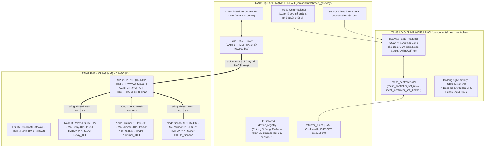

# Bản Thiết Kế Tổng Thể Hệ Thống Thread Mesh (Master System Blueprint)
> **Dự án**: ESP32-S3 Voice Gateway tích hợp Mạng Thread Mesh (OpenThread Border Router)  
> **Phiên bản**: v2.2 - Khắc phục triệt để lỗi bộ nhớ DMA SRAM và cơ chế Graceful Degradation chống reboot loop khi RCP offline.

---

## 1. Kiến Trúc Phân Tầng Hệ Thống (Layered Architecture)

Hệ thống được quy hoạch phân tách mạch lạc thành **2 component độc lập**, tách biệt hoàn toàn giữa *Hạ tầng mạng vô tuyến cấp thấp* và *Tầng điều phối ứng dụng cấp cao*:



---

## 2. Kiểm Soát Bộ Nhớ Chi Tiết & Giải Pháp Chống Cạn Kiệt DMA (Memory Architecture)

Do Gateway phải đồng thời gánh rất nhiều tác vụ nặng (Đồ họa LVGL màn hình màu, Thu âm I2S DMA, Trợ lý giọng nói Edge/Cloud AI, Kết nối ThingsBoard MQTT qua TLS, và OpenThread Border Router), **kiến trúc bộ nhớ được chuẩn hóa nghiêm ngặt**:

### 2.1. Thứ Tự Khởi Tạo Phần Cứng Bắt Buộc trong `app_main`:
1. **`audio_hal_init()` (Tiên quyết #1)**: Cấp phát bộ đệm phần cứng DMA (INMP441 Microphone RX & MAX98357A Speaker TX) ngay từ đầu khi SRAM nội bộ còn 100% nguyên vẹn (Zero fragmentation).
2. **`ui_display_init()` (Tiên quyết #2)**: Cấp phát SPI LCD DMA và LVGL double-buffer (`MALLOC_CAP_DMA | MALLOC_CAP_INTERNAL`).
3. **`sys_core_init()` (Tiên quyết #3)**: Bật Wi-Fi, NVS, SoftAP Provisioning sau khi vùng nhớ DMA đã được khóa cố định. Wi-Fi và TCP/IP sử dụng các vùng nhớ động phân tán và ưu tiên PSRAM.
4. **`mesh_controller_init()`**: Khởi tạo OpenThread Border Router Host stack.
5. **`iot_cloud_init()`, `ai_cloud_init()`, `ai_edge_init()`**: Khởi chạy các dịch vụ đám mây và lắng nghe âm thanh.

### 2.2. Tối Ưu Hóa Kích Thước DMA Frame & Wi-Fi Buffers:
- **Audio I2S DMA**:
  - `rx_chan_cfg.dma_desc_num = 6`, `dma_frame_num = 240` (~90ms hardware DMA buffer, chỉ tốn ~2.8KB DMA SRAM thay vì 32KB). Dữ liệu sau đó được đọc ngay vào PSRAM buffer.
  - `tx_chan_cfg.dma_desc_num = 6`, `dma_frame_num = 240` (~60ms hardware DMA cushion, chỉ tốn ~2.8KB DMA SRAM thay vì 15.4KB). Đệm âm thanh chính nằm ở **2MB RingBuffer trên PSRAM** (`tx_ringbuf`).
  - **Tiết kiệm tổng cộng > 42KB contiguous DMA SRAM**!
- **Wi-Fi Buffers**:
  - `CONFIG_ESP_WIFI_DYNAMIC_RX_BUFFER_NUM=32` (giảm từ 64 xuống 32, cực kỳ ổn định cho streaming audio 24kHz).
  - `CONFIG_ESP_WIFI_STATIC_RX_BUFFER_NUM=8` (giảm từ 16).
  - `CONFIG_ESP_WIFI_RX_BA_WIN=6`, `CONFIG_ESP_WIFI_TX_BA_WIN=6`.
  - `CONFIG_SPIRAM_MALLOC_RESERVE_INTERNAL=49152` (48KB): Luôn bảo toàn tối thiểu 48KB Internal SRAM cho các tiến trình hệ thống DMA quan trọng.
  - `CONFIG_SPIRAM_TRY_ALLOCATE_WIFI_LWIP=y`: Ép các socket mạng và buffer lwIP phân bổ từ PSRAM 8MB.

---

## 3. Cơ Chế Chống Treo & Tự Phục Hồi Khi Mất Kết Nối RCP (Graceful Degradation)

### 3.1. Vấn Đề Gốc Rễ Trước Đây:
- Khi ESP32-H2 RCP chưa cắm, lỏng dây, hoặc chưa nạp firmware UART, Spinel driver trên S3 gửi frame reset nhưng không nhận được phản hồi (`Wait for response timeout`).
- OpenThread kích hoạt callback `ot_spinel_coprocessor_reset_failure_callback`. Do callback này chưa được đăng ký, nó kích hoạt `assert(s_coprocessor_reset_failure_callback)` làm Gateway sập nguồn và lặp lại vòng reboot (Panic Reboot Loop).
- Thậm chí nếu callback trả về bình thường, OpenThread tiếp tục gọi `DieNow(OT_EXIT_FAILURE)` (gọi `exit(1) -> abort()`).

### 3.2. Cơ Chế Khắc Phục Triệt Để:
1. Đăng ký hàm xử lý `rcp_reset_failure_cb` thông qua `esp_openthread_set_coprocessor_reset_failure_callback(rcp_reset_failure_cb)`.
2. Khi xảy ra lỗi kết nối co-processor:
   - Ghi log chẩn đoán phần cứng rõ ràng (sơ đồ chân, baud rate).
   - Đánh dấu `s_rcp_connected = false`.
   - Giải phóng `s_ot_init_sem` để `thread_gateway_init()` không bị treo vô hạn.
   - **Thực hiện `vTaskDelete(NULL)`** để kết thúc an toàn task `ot_br_main`, chặn đứng hoàn toàn việc luồng thực thi chạm tới `DieNow(OT_EXIT_FAILURE) / abort()`.
3. Gateway tự động chuyển sang **Standalone Mode**:
   - Màn hình UI, Cảm ứng, Wi-Fi, Loa, Mic, ThingsBoard Cloud, Edge AI tiếp tục chạy 100% mượt mà bình thường.
   - Các lệnh điều khiển thiết bị Thread phản hồi mã lỗi `ESP_ERR_INVALID_STATE` mà không bao giờ làm crash hệ thống.

---

## 4. Sơ Đồ Đấu Nối Vật Lý (Hardware Wiring & Pinout)

| Tín hiệu | ESP32-S3 (Voice Gateway) | ESP32-H2 (Radio RCP) | Ghi chú |
| :--- | :--- | :--- | :--- |
| **TX $\rightarrow$ RX** | **GPIO 18** (UART1 TX) | **GPIO 4** (UART1 RX) | S3 gửi lệnh Spinel sang H2 |
| **RX $\leftarrow$ TX** | **GPIO 14** (UART1 RX) | **GPIO 5** (UART1 TX) | H2 phản hồi dữ liệu Spinel về S3 |
| **GND** | **Chân GND** | **Chân GND** | **Bắt buộc nối chung mass** |
| **Baud Rate** | **460,800 bps** | **460,800 bps** | Cấu hình đồng bộ cả 2 chip |
| **Cổng Nạp H2** | *(Không ảnh hưởng)* | **UART0 (GPIO 23/24 / Cổng USB)** | Cho phép vừa cắm máy tính nạp/debug vừa nối với S3 |

---

## 5. Hướng Dẫn Nạp Firmware Cho ESP32-H2 RCP

Firmware H2-RCP đã được hiệu chỉnh sạch trong thư mục: `D:\PTIT\DATN_PTIT\thread_mesh_repos\H2-RCP`.

Để nạp lại code cho module ESP32-H2:
```powershell
# 1. Kích hoạt môi trường ESP-IDF (trong PowerShell)
. 'C:\Espressif\frameworks\esp-idf-v5.4.3\export.ps1'

# 2. Di chuyển vào thư mục H2-RCP
cd 'D:\PTIT\DATN_PTIT\thread_mesh_repos\H2-RCP'

# 3. Nạp firmware vào cổng COM của ESP32-H2 (ví dụ COM9)
idf.py -p COM9 flash
```

---

## 6. Quy Trình Trải Nghiệm Người Dùng (UI/UX Specification)

### 6.1. Tab Thiết Bị (Device Management):
* **Bố cục Lưới 2 cột (2-Column Grid) & Empty State**:
  - Khi chưa có thiết bị: Hiển thị Thẻ trống (**Empty State**: "Chưa có thiết bị trong mạng Thread" + nút `[ + Thêm thiết bị ]`).
  - Khi có 1 thiết bị: Tự động xếp ở **Ô 0 (Trái)**, không căn giữa! Thẻ `[ + Thêm thiết bị ]` xếp ở **Ô 1 (Phải)**.
  - Khi có 2 thiết bị: Thiết bị 1 ở Ô 0 (Trái), Thiết bị 2 ở Ô 1 (Phải). Thẻ `[ + Thêm thiết bị ]` tự động chuyển xuống **Ô 2 (Hàng 2 Trái)** và cho phép cuộn màn hình.
  - Nhấn giữ (Long-press) vào thẻ thiết bị bất kỳ $\rightarrow$ Hiện hộp thoại xác nhận **Gỡ bỏ thiết bị** khỏi mạng Thread và NVS registry.
* **Cửa Sổ Quét Ghép Nối 60 Giây & Universal Commissioning**:
  - Khi người dùng nhấn `[ + Thêm thiết bị ]` $\rightarrow$ Mở Popup Quét với thanh đếm lùi 60s.
  - Toàn bộ hệ thống thống nhất mã PIN ghép nối chuẩn Matter/Thread: **PSKd `"DATN2026"`**, duy trì ổn định xuyen suốt 60s (loại bỏ hoàn toàn xoay vòng timer gây đứt phiên DTLS).
  - Khi thiết bị Joiner phát tín hiệu $\rightarrow$ Hiển thị Thẻ Quét:
    - Tiêu đề định danh phần cứng: `Thiết bị mới [MAC ...D6A6]` (hoặc `Công tắc [Relay-D6A6]`)
    - Thông tin mạng & sóng: `Mạng: OpenThread-PTIT • -45dBm` (giúp phân biệt rõ ràng với mạng nhà khác)
    - Nút tròn tick xanh `( ✔ )`: Người dùng chạm vào để phê duyệt cấp quyền vào mạng.
    - Nút `[ Hủy ]`: Đóng popup và hủy phiên ghép nối an toàn.

### 6.2. Tab Môi Trường (DHT11 Sensor Experience):
* **Khi CHƯA có Cảm biến**:
  - Hiển thị `--.- °C` và `-- %`.
  - Chạm vào thẻ $\rightarrow$ Hiện Toast cảnh báo *"Chưa kết nối cảm biến. Vui lòng thêm thiết bị trong Tab Thiết bị"*. Tự động biến mất sau **2 giây** hoặc khi chạm ra ngoài.
* **Khi ĐÃ kết nối Cảm biến**:
  - Nhiệt độ & độ ẩm hiển thị thời gian thực với font số lớn **32px**, đồng bộ 10s/lần.

---

## 7. Trạng Thái Triển Khai Thực Tế (Implementation Status)

- [x] **Giai đoạn 1**: Cấu hình bộ nhớ, DMA headroom, OpenThread Border Router, lwIP IPv6 forward, mbedTLS DTLS.
- [x] **Giai đoạn 2**: Xây dựng component `components/thread_gateway` với cơ chế Graceful Degradation chống panic reboot khi RCP offline.
- [x] **Giai đoạn 3**: Nâng cấp `mesh_controller` và `gateway_state_manager` (Quản lý trạng thái động, cờ `is_online`, đếm số node thực tế, đồng bộ ThingsBoard Cloud & Voice AI).
- [x] **Giai đoạn 4**: Hoàn thiện Giao diện `ui_display` (Lưới 2 cột cuộn dọc, Thẻ Thêm thiết bị ở ô kế tiếp, Popup Quét 60s hiển thị mã [Tên-MAC] & nút `( ✔ )`, Toast môi trường tự tắt 2s).
- [x] **Cấu hình & Biên dịch H2-RCP**: Firmware ESP32-H2 RCP biên dịch 100% thành công trên cổng UART1 (TX:5, RX:4 @ 460800bps).
