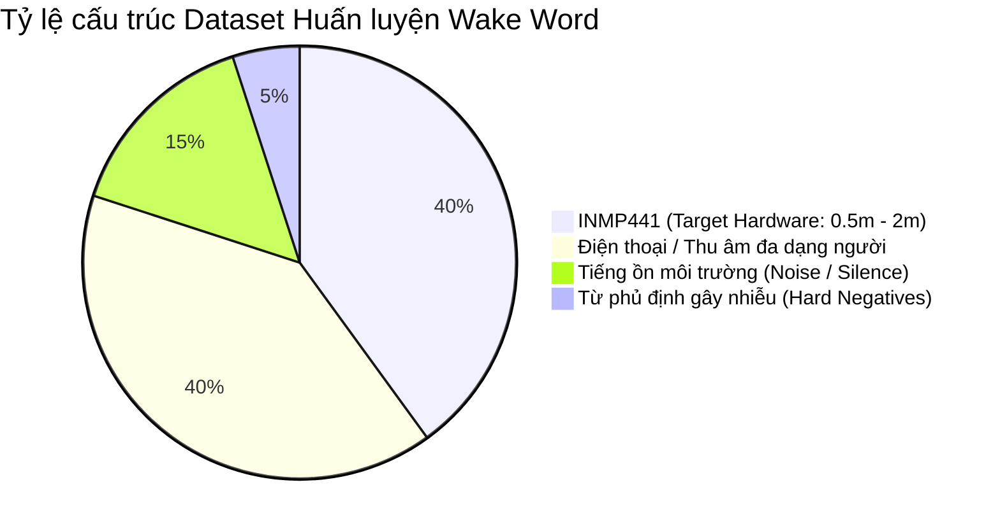

# Kế hoạch Chiến lược: Thu thập dữ liệu, Đánh giá phần cứng Mic và Huấn luyện Wake Word AI (Edge Impulse)

Tài liệu này phân tích chi tiết các phương án phần cứng thu âm (Microphone), chiến lược xây dựng tập dữ liệu (Dataset Collection) chống lệch miền âm học (Domain Shift), quy trình huấn luyện trên Edge Impulse và lộ trình triển khai lên ESP32-S3 cho Đồ án Tốt nghiệp (DATN PTIT).

---

## 1. Phân tích So sánh & Đánh giá Phần cứng Microphone

### 1.1. Hiện trạng: Module INMP441 (Single MEMS I2S)
- **Đặc tính kỹ thuật**:
  - Giao tiếp số I2S trực tiếp (không qua ADC rời, không nhiễu analog).
  - Tần số đáp ứng: 60 Hz – 15 kHz.
  - Tỷ số tín hiệu trên nhiễu (SNR): ~61 dBA (Omnidirectional - đa hướng).
  - Độ nhạy: -26 dBFS.
- **Ưu điểm**:
  - Giá thành rất rẻ (15.000 – 25.000 VNĐ), cực kỳ phổ biến.
  - Đã tích hợp sẵn driver chuẩn I2S Philips trong `audio_hal.c` đang hoạt động ổn định.
- **Hạn chế đối với nhận diện từ xa (Far-Field > 1.5m)**:
  - Do là mic đa hướng đơn (Single Omnidirectional), nó thu đều mọi hướng bao gồm cả âm vang phòng (reverberation) và tiếng ồn môi trường (quạt, điều hòa, tiếng nói chuyện xung quanh).
  - Cự ly nhận diện tốt nhất: **0.3m – 1.5m**. Ở cự ly > 2m, tỷ lệ SNR giảm mạnh, giọng người bị chìm vào nhiễu nền nếu không có tiền xử lý.

### 1.2. Có nên đổi sang Module Mic khác hoặc Mic Array không?

| Phương án | Chi phí & Độ phức tạp | Tầm thu hiệu quả | Đánh giá tính khả thi cho Đồ án |
| :--- | :--- | :--- | :--- |
| **A. Giữ nguyên INMP441 + Tối ưu Software DSP** | Rất thấp (Tận dụng phần cứng sẵn có) | **0.5m – 1.5m** (Đủ tốt cho mô hình Desk/Smart Home Assistant cự ly gần) | **(Khuyến nghị cho giai đoạn này)**: Đạt tiêu chuẩn ĐATN, tiết kiệm thời gian, tập trung vào kiến trúc hệ thống và AI. |
| **B. Đổi sang MEMS đơn cao cấp hơn (ICS-43434 / SPH0645)** | Thấp (~50k – 80k VNĐ), chân cắm tương tự | **0.8m – 1.8m** (SNR ~65 dBA, bớt nhiễu nền hơn một chút) | Cải thiện nhẹ (~10-15%), không tạo ra bước nhảy vọt về cự ly xa do vẫn là mic đơn. |
| **C. Tích hợp Dual-Mic Array + ESP-SR (ESP32-S3)** | Trung bình (Cần 2 mic INMP441 đặt cách nhau 40-60mm, bật thư viện ESP-SR Acoustic Preprocessing) | **1.5m – 3.0m** (Hỗ trợ Beamforming định hướng, loại bỏ tiếng ồn nền) | Nâng cao điểm số đồ án nếu có thời gian, nhưng đòi hỏi thiết kế cơ khí/vỏ hộp cố định khoảng cách giữa 2 mic. |
| **D. Module DSP chuyên dụng (ReSpeaker 2-Mic / XMOS XU316)** | Cao (300k – 600k VNĐ), mạch cồng kềnh | **3.0m – 5.0m** (Có chip xử lý phần cứng AEC, Beamforming, NS) | Thừa thãi và tốn kém không cần thiết cho mục tiêu đánh giá mô hình Edge Impulse trên ESP32-S3. |

> [!TIP]
> **Khuyến nghị kiến trúc phần cứng:**
> Hãy **tiếp tục sử dụng INMP441** cho giai đoạn huấn luyện và nghiệm thu cốt lõi này. Khoảng cách 1 – 1.5m là cự ly chuẩn mực của các thiết bị để bàn. Nếu sau này cần nâng cấp điểm số đồ án, giải pháp mở rộng khả thi nhất là lắp thêm 1 mic INMP441 thứ 2 để chạy **ESP-SR Dual-Mic Beamforming**.

---

## 2. Chiến lược Thu thập Dữ liệu (Phone vs. INMP441)

### 2.1. Vấn đề "Lệch miền âm học" (Acoustic Domain Shift)
- **Nếu chỉ thu bằng Điện thoại**: Micro điện thoại (iPhone/Samsung) có bộ lọc phần cứng (Noise Suppression, AGC, High Dynamic Range). Dữ liệu thu được rất "sạch" và "dày". Khi nạp mô hình vào ESP32 chạy mic INMP441 (vốn có tiếng xì nền riêng, đáp ứng tần số phẳng hơn), mô hình sẽ bị **bỡ ngỡ**, dẫn đến tỉ lệ nhận diện sai (False Acceptance / False Rejection) rất cao!
- **Nếu chỉ thu bằng INMP441**: Số lượng mẫu và độ phong phú (nhiều người nói, các vùng miền, giới tính, lứa tuổi) sẽ bị hạn chế do việc thu thập qua mạch nhúng tốn thời gian hơn.

### 2.2. Chiến lược Tập dữ liệu Lai (Hybrid Dataset Strategy)
Để mô hình đạt độ chính xác > 92% trên thiết bị thực tế, tập dữ liệu huấn luyện cần được chia theo tỷ lệ vàng:

1. **40% Mẫu từ chính module INMP441 (ESP32-S3)**:
   - Thu trực tiếp người dùng chính ở các khoảng cách: 0.5m, 1m, 1.5m.
   - Thu ở các góc nói khác nhau (thẳng diện, chéo 45 độ).
   - Thu trong 2 điều kiện: phòng yên tĩnh và phòng có tiếng ồn nền (bật quạt, mở video YouTube nhỏ).
2. **40% Mẫu từ Điện thoại / Nguồn ngoài**:
   - Nhờ bạn bè, người thân (nam, nữ, ngữ điệu khác nhau) ghi âm lại câu Wake Word (khoảng 30 - 50 người, mỗi người nói 3-5 lần).
3. **15% Mẫu Noise / Background**:
   - Tiếng quạt máy, tiếng gõ phím, tiếng còi xe, tiếng im lặng phòng (ambience).
4. **5% Mẫu Hard Negatives (Từ gây nhiễu)**:
   - Những từ có phát âm gần giống Wake Word để tránh kích hoạt giả.

---

## 3. Khả năng tương thích của Edge Impulse với File .WAV

> [!IMPORTANT]
> **Edge Impulse HOÀN TOÀN HỖ TRỢ và KHUYẾN NGHỊ sử dụng file `.wav` thô!**

- **Định dạng tối ưu nhất**:
  - Định dạng: **WAV (PCM 16-bit, Signed Integer)**.
  - Tần số lấy mẫu: **16.000 Hz (16 kHz)** (Trùng khớp 100% với cấu hình I2S trong `audio_hal.c`).
  - Số kênh: **Mono (1 kênh)**.
  - Độ dài mẫu: **1 giây (1.000 ms)** cho mỗi từ khóa.
- **Tính năng tự động của Edge Impulse**:
  - Hỗ trợ **Batch Upload** (tải lên cùng lúc hàng trăm file .wav).
  - Tự động chia tập **Train (80%) / Test (20%)**.
  - Tính năng **Audio Splitting**: Cho phép người dùng thu một file WAV dài 1-2 phút nói liên tục từ khóa (cách nhau 1-2 giây), sau đó Edge Impulse sẽ tự nhận diện khoảng lặng để cắt thành từng mẫu 1 giây riêng biệt.

---

## 4. Kế hoạch Triển khai Chi tiết

### Bước 1: Xây dựng Công cụ Thu âm WAV trực tiếp trên ESP32-S3
- Tạo một cơ chế nhanh trong firmware (hoặc một tool script Python kết nối Serial) để:
  - Bấm phím trên bàn phím -> ESP32 ghi đúng 1 giây (16.000 mẫu = 32.000 bytes) từ mic INMP441.
  - Gửi dữ liệu PCM thô hoặc ghi đóng gói header WAV gửi thẳng qua cổng USB-Serial COM lên máy tính.
  - Script Python trên máy tính tự động lưu thành các file `wakeword_inmp441_001.wav`, `wakeword_inmp441_002.wav`...

### Bước 2: Chuẩn bị Dataset & Cắt lát (Slicing)
- Thu thập tối thiểu:
  - Lớp `wake_word` (Ví dụ: "Hey Assistant" hoặc "Bật đèn"): ~150 - 300 mẫu.
  - Lớp `noise` (Tiếng ồn môi trường): ~100 mẫu (1 giây/mẫu).
  - Lớp `unknown` (Các từ nói tiếng Việt ngẫu nhiên khác): ~150 mẫu.

### Bước 3: Cấu hình Impulse trên Edge Impulse Studio
1. **Create Impulse**:
   - Time series data: Window size = `1000ms`, Window increase = `100ms`, Frequency = `16000Hz`.
2. **Processing Block: Audio (MFE - Mel-Filterbank Energy)**:
   - Tối ưu cho vi điều khiển có hỗ trợ tập lệnh tăng tốc DSP Vector như ESP32-S3.
   - Khung phân tích FFT: 512, Step: 0.02s.
3. **Learning Block: Classification**:
   - Mô hình mạng 1D/2D CNN (Conv1D / Conv2D) gọn nhẹ (~30KB - 80KB Flash, < 20KB RAM).
4. **Optimization & Deployment**:
   - Sử dụng **EON Tuner** để tìm kiến trúc mô hình có độ trễ < 50ms trên ESP32-S3.
   - Xuất gói triển khai: **C++ Library** (chứa trọn gói file code C/C++ inference).

### Bước 4: Tích hợp vào Firmware (`components/ai_edge/ai_edge.c`)
- Thay thế hoàn toàn task đọc bàn phím `keyboard_input_task` bằng **Continuous Audio Inference Pipeline**:
  - Mic INMP441 liên tục đổ dữ liệu vào Rolling Buffer (Ring Buffer 1 giây).
  - Chạy hàm `run_classifier_continuous()` của Edge Impulse trên Core 1.
  - Khi xác suất `wake_word > 0.85`:
    - Phát âm thanh phản hồi Wake sound (`audio_hal_play_wake_sound()`).
    - Bắt đầu mở phiên giao tiếp Cloud (`ai_cloud_start_turn()`).

---

## 5. Kế hoạch Kiểm tra & Nghiệm thu (Verification Plan)

### Kiểm tra Huấn luyện (Trên Studio)
- Độ chính xác (Accuracy) trên tập Test đạt: **> 90%**.
- Độ trễ suy luận (Latency) trên ESP32-S3 (ESP-NN Vectorized): **< 40 ms**.
- Bộ nhớ RAM tiêu thụ: **< 30 KB SRAM**.

### Kiểm tra Thực tế Phần cứng (Manual Hardware Test)
- **Kiểm tra độ nhạy (True Positive Rate)**: Đứng ở khoảng cách 0.5m, 1.0m, 1.5m nói Wake Word 10 lần mỗi vị trí -> Đạt tối thiểu 8/10 lần kích hoạt.
- **Kiểm tra chống kích hoạt nhầm (False Positive Rate)**: Bật một đoạn tin tức YouTube hoặc nói chuyện bình thường trong phòng 15 phút -> Số lần tự kích hoạt nhầm = 0.
